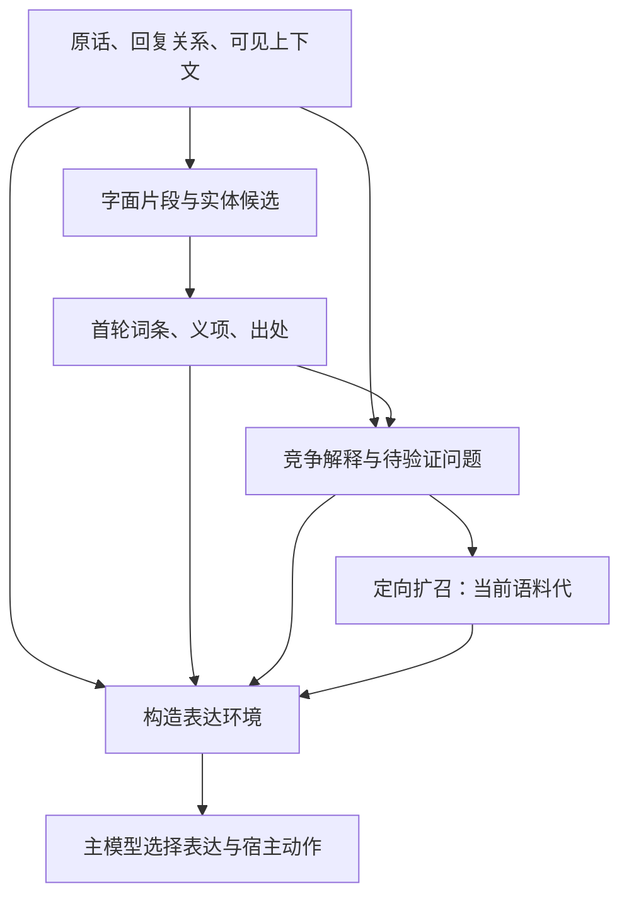

# 梗知识前置、假设驱动扩召与表达环境设计

日期：2026-10-30。状态：设计评审稿，附离线验证；生产结构尚未实现或切换。

目标是让机器人先拿到可追溯的背景知识，再解释语境、扩召和表达，减少错误解读自我强化。支持历史、政治、地狱笑话，以及贴合情境的挖苦、反讽和适度冒犯。最终质量按贴合、自然、锋芒和交际效果判断，不能用词条数量、回复数量或模型自评分替代。

设计依据见[案例诊断](../../architecture/2026-10-30-meme-grounding-case-analysis.md)，本轮执行证据与未通过项见[伴随验证](../../architecture/2026-10-30-meme-knowledge-first-validation.md)。本文的预算、验收门槛和新增契约均为方案要求，不代表已有生产能力。

## 1. 需要解决的具体问题

“三年，从钢铁雄心玩成海岛奇兵”在现链路中被规划模型解释成“硬核策略转休闲手游”；同轮关键词按数组顺序限制为前两条，海岛奇兵被丢弃。错误的语义解释参与了后续检索，最终回答也偏向游戏玩法变化。

此前已确认：该历史影射词条在库内；直接整句 BM25 前置会受到对话指令等词影响；确定性匹配词条名再检索能找回知识，但单纯前置知识仍不能阻止关键词再次截断。最新原型又显示：模型能保留两种解释，也会在认真询问游戏机制时多猜一个影射解释；查询的来源标签也需要服务端校验。

需要同时处理信息顺序、字面锚点保护、来源边界、语境消歧和表达环境。扩大梗库与更换模型可以独立评估，不能替代这些契约。

## 2. 方案选择

| 路线 | 优点 | 代价与使用位置 |
| --- | --- | --- |
| **推荐：字面知识前置，一次规划，定向扩召，合并环境** | 原始锚点独立存在；每层可定位；普通路径保持一次语义规划 | 需要代际词典、来源契约和环境适配；本方案先实现此路线 |
| 模型主动多轮取证 | 适合复杂指代、需要连续排除解释的场景 | 增加调用和延迟；作为后续独立实验，首版不开启递归扩召 |
| 更强先验模型或领域训练 | 可能改善隐含典故与表达迁移 | 有模型、训练与维护成本；仍要处理新梗、来源版本和错误先验；放入后续消融对照 |

## 3. 总体结构

原话和首轮知识都有直达最终环境的路径。扩召不能覆盖它们。模块输出少量、有出处的背景、解释摘要和用法；宿主继续决定参与、工具、审批与投递。

### 必须保持的契约

| 编号 | 要求 |
| --- | --- |
| K01 | 原文不可被分词、归一化、实体链接或模型改写替换；每个字面片段可回到原消息和 rune 区间 |
| K02 | 分词、NER、词性和实体链接均是分析候选；词典命中也只证明字面匹配，不证明本轮使用该义项 |
| K03 | 原话观察、知识释义、模型假设、创作表达分开标识；用户陈述也不自动升级为经核实的外部事实 |
| K04 | 请求固定 generation、语料哈希、词典哈希；不能混用另一代别名、知识或用法卡 |
| K05 | 已选字面锚点独立于模型关键词数组保留；超预算必须记录遗漏，不能承诺无限保留 |
| K06 | 扩召可以为空、失败或不需要；已经验证的背景仍进入环境 |
| K07 | literal 查询由服务端根据原文引用生成；知识关联和假设查询必须分别标记来源 |
| K08 | 模型自报的原文、来源标签、支持度和置信度都不构成校验依据 |
| K09 | 保留多义时需要证据；明确的本义限定、否定和认真求助不能因存在梗义而被覆盖 |
| K10 | 梗知识不产生发言义务；适度冒犯是表达能力，参与时机仍结合真实语境 |
| K11 | 词条、别名、义项和同源用法去重，但原始命中及被丢弃项保留在诊断证据中 |
| K12 | 失败时回到原话和可验证信息，继续正常宿主流程，不丢失任务或扩大副作用范围 |

## 4. 知识与用法分别组织

### 4.1 知识词条 `KnowledgeEntry`

知识层回答“这个词可能指什么”。字段包括稳定词条标识、标题、别名、义项、短释义、背景关联、来源与版本、内容指纹、可见范围、generation。

每个义项保留出处及类型：`community_usage`、`wiki_explanation`、`verified_background`、`inferred_annotation`。梗设定、历史事实和自动归纳不能互相代替。同一词同时拥有游戏本义、历史影射等义项是正常情况。

强字面入口采用原始标题和有来源绑定的别名。当前自动编码产生的相关词、别名候选不能仅凭字段名就升级成已证实别称；保留 `inferred` 状态及其依据，作为较弱检索线索。实体共现也不等于别名关系。

### 4.2 用法卡 `UseCard`

用法层回答“什么关系下能怎么接”。沿用现有 use/family 标识、原文、适用条件、角色、视角、评价对象、模板、可替换槽位、正例和近似反例。角色与模板补充使用现有离线编译能力，原始来源与模型构造示例分开。

先验入口按词条/来源去重，避免同一正文拆出的五张用法卡挤满背景；用法阶段仍可比较同一梗的不同用法。背景释义和用法说明是两个预算，不以其中一个的数量代替另一个。

### 4.3 发布与数据归属

复用 PG、现有 Milvus 和语料发布流程。新增不可变的知识记录类别/表 `meme_knowledge_records`，保存知识词条、分块词典和知识 manifest。单块上限 1MiB，首版词典元数据总大小上限 32MiB；释义和用法正文按引用从 PG 读取，不把整库正文放进在线词典。

新的语料 manifest 绑定 `knowledge_manifest_id/hash`、词典构建版本、源记录指纹集合及既有四个用法索引。词典只从该代明确绑定的来源与记录生成，不能扫描同 scope 的全部历史版本冒充活动代。全部准备并验证后，才切换一个 active 指针。

旧 manifest 和 V1 读取保持兼容。新模块遇到旧代缺少知识 manifest 时标记 `knowledge_unavailable`，由兼容路径处理；不能临时借用另一代词典。热缓存按代持有不可变快照，请求持引用，切换不改变运行中请求。全局撤回和可见范围检查仍优先于冻结代。

## 5. 第一层：观察、字面锚点与背景召回

输入沿用宿主已经限定的当前消息、因果材料和近期对话窗口，不在梗模块重新扩大历史范围。

1. 保留原文与版本，生成多粒度片段；使用标题/别名匹配、连续词组与字符片段等入口。
2. 分词、实体与词性标注作为可选插件，附方法与模型/词典版本，不把候选实体当用户已经指明的对象。
3. 采用可追溯的搜索视图处理兼容字形、拉丁大小写等。原文 rune 区间不变；规范化后的搜索词不能冒充原话。
4. 首先查询已知标题和别名，再对有限片段做 BM25。普通整句可以作为降级线索，不能占满高区分度入口。
5. 返回少量词条及其义项、出处，暂不选择“本轮就是这个意思”。

预算初值：最多 64 个片段候选，选择最多 6 个知识锚点；每词条最多展示 2 个主要义项，其他义项计入 `omitted_senses`。短词不按四字下限删除。优先级依次考虑有来源的精确标题、别名、特异度、当前轮相关位置，再稳定排序；相同输入不受词典遍历或模型关键词顺序影响。歧义与被省略内容必须传给后续层。

确定性原词匹配与 PG 批量按标识取记录不消耗语义规划调用。额外片段搜索最多 2 个逻辑查询。词典在运行时预热，冷热加载分开度量；先前的 6/10ms 只是两个热路径样例，不是整库 P95。

## 6. 第二层：带知识的解释与定向扩召

普通路径只有一次规划模型调用。输入包含原话观察、首轮词条、已有交际上下文和剩余预算；输出最多 2 个主要解释、未决问题和最多 3 个扩召查询，不强行凑满。

解释只保存简短、可审阅的内容和引用，不依赖模型私有推理文本。每个解释包含语境含义、交际作用候选、原话引用、知识引用、反证引用和缺失信息。交际作用候选包括玩笑续接、邀请调侃、真实提问、分享和未确定；宿主仍负责最终行为判断。

### 查询来源

| 来源 | 允许的内容 | 服务端校验 |
| --- | --- | --- |
| `literal` | 原话片段或其服务端搜索投影 | 模型只选择原文引用；服务端构造文本，拒绝自报的替代原文 |
| `knowledge_link` | 来自已提供知识的别称、背景关联 | 至少一个有效知识引用及原话引用；记录它是知识关联 |
| `hypothesis_probe` | 为检验解释提出的新组合或联想 | 引用有效解释和原话，保留假设属性；不能冒充已知事实或已给知识 |

所有引用从服务端冻结快照解析，未知编号、跨群、跨代、失效指纹和不满足条件的查询被拒绝。来源标签正确并不证明语义正确，后者仍需案例评测。拒绝单个查询时保留合法查询和背景，不自动把错误来源改标成“字面查询”。

查询必须回答一个会影响理解或表达的问题，例如“这个游戏名在此处是否承担历史影射”。“缺少机器人身份/损人尺度”等无关不确定性不应自动触发扩召或追问用户。信息不足不等于一律向用户澄清。

首版扩召限定在当前梗语料代；群记忆、当前史实核对仍使用宿主已有工具与权限边界。扩召一批执行后把证据交给主模型，不递归重新规划。停止原因包括已有足够上下文、普通事实问题无需梗扩召、没有有用问题、预算耗尽、来源不可用。

全链路共享最多 7 个逻辑搜索查询，包含失败查询；首轮用掉的片段搜索扣减后续预算。首版规划最多 3 个查询的配置可小于总上限。取消 V1 中“模型数组前两个关键词决定全部字面入口”的职责：字面锚点由第一层保留，语义查询按待解决问题分配，而非机械平分各维。

## 7. 第三层：表达环境与生成

环境由服务端组装为五类：`Observations`、`PriorKnowledge`、`Interpretations`、`RetrievedUses`、`ExpressionContext`。每类携带来源和代际引用。知识保留有独立通道；扩召为空、超时或重新排序都不能清空已经验证的锚点。

环境先保证原话、明确限定及因果上下文。梗模块额外环境上限建议 24KiB，其中知识最多 8KiB、解释最多 4KiB、用法视图最多 12KiB。已选锚点的短摘要与出处引用先保留，再装入可选详情。空间不足时去掉整个可选用法/释义段，记录遗漏，不截断适用条件或改写原文；连最小锚点环境都放不下时整项降级，不挤掉主对话。

权威 `UseCard.Full` 和指纹保持不变；上下文可以使用带指纹的 `UseView`，以知识引用代替同源重复说明。视图不是新语料版本，服务端必须能证明其引用来自原记录。

需要接梗的回合，主模型在同一次生成中比较：

- 已有表达：原句引用、短句式、恰当的槽位替换；
- 自然改造：谐音/双关、结构类比、含义迁移、反差反转、字面化、角色置换、跨梗组合；
- 表达姿态：反讽、挖苦、调侃、自嘲，可与前两类组合。

这些机制是可扩展分类，不是穷尽幽默的算法，也不各占一次模型调用。选择顺序重视语境贴合、靶点正确、可辨认性、自然度、锋芒，再考虑新鲜度。已有梗并非必须照抄，新构造也不能把资料里的事件、身份或经历安到群成员身上。

历史、政治和地狱笑话作为正常知识与表达类别收录。适度攻击性要保留其指向和修辞作用，不能统一洗成中性解释；同时，“认真问游戏机制”和“请损一句”应产生不同表达。输出仍遵守宿主协议，群里只看到自然回复，不展示候选、检索过程或评分。

## 8. 时延、失败与观察

初版沿用梗参考总预算 12 秒、模型/阶段最多 8 秒，所有层使用同一个父期限。第一层最多 500ms；规划和扩召分别受自身上限与剩余时间限制，不把各阶段上限相加成额外等待。普通路径一次语义规划，结构修复至多沿用现有一次且计入时间和调用；不新增在线适用性打分调用。主模型的事务工具循环继续由宿主总预算管理。

一次规划不意味着 token 或时延不增长。本轮新协议样例规划耗时约 2.0–5.5 秒；更完整的输出、更多背景和扩召成本都需要全链路基准。不能用词面检索的 6ms 宣称整体更快。单次 turn 两分钟与持久任务有效期继续保持各自语义。

| 失败位置 | 行为 |
| --- | --- |
| 词典/知识 manifest 不匹配 | 不使用不匹配知识；保留原话并走兼容路径 |
| 无字面命中 | 标记 `no_anchor`，允许基于原话做正常分析，不编造先验引用 |
| 规划超时或结构不合法 | 保留已有知识，跳过扩召，交宿主继续回答 |
| 单条查询不合法 | 拒绝该条，保留其余证据和明确诊断 |
| 扩召超时/无候选 | 保留首轮知识，不把空结果说成“没有这个梗” |
| 权威来源校验失败 | 排除失效记录，不从模型输出补回 |
| 表达没有合适素材 | 结合本轮需要正常回应或旁听，不机械进入嘲讽 |

V2 输出独立记录各层状态，不能用 V1 的“没有候选卡”清空已经有效的知识。记录原词、匹配类型、代际、候选与遗漏、解释摘要、查询来源、拒绝原因、保留锚点、用法、耗时、token 和真实投递回执。沿用已有 payload 诊断能力并脱敏凭证；不把模型自报 use_id 当作幽默成功证明。

## 9. 接入现有工程与来源更新

共享业务契约与编译放在 `internal/application/lark/memes`；代际知识记录、发布与读取放在 `internal/infrastructure/memestore`；检索适配放在 `internal/infrastructure/mememilvus`，阶段组合放在 `internal/infrastructure/memeruntime`。这些包分别位于 next 与 meme-reply-master 工作树，不将改动误写入不含这些包的主工作树同名路径。

`memereference` 增加 V2 环境格式化入口，保留 V1 卡片格式。next 的 `cmd/lark-agent/meme_references.go` 和 engine scene 接收知识与解释；master 的回复生成适配同一契约。V2 使用显式版本/能力开关，旧宿主不会因新字段自动启用新行为。现有 `ReferenceResult` 可增加可选的版本化上下文，但 V1 状态与卡片行为保持兼容；两个宿主都需要完成适配与验证。

首轮优先把已存在却难以使用的来源整理成知识和用法。持续增量来源采用：社区原帖、梗图、B站原视频及评论供实际接法；Wiki/专题资料供释义及背景线索。每条保存原链接、原文快照、版本、内容哈希、别称/义项依据和真实例子；历史背景与网络夸张分别标记。公开梗与群内材料保持可见范围，群内好句不能自动进入公共库。

新增来源经过采集、去重、编译、来源核对、固定代构建和回放后再激活。热度只作发现线索，不替代用法贴合与来源事实。来源、结构、表达和语料规模分别做消融，不能同时大幅换库、换模型、换口吻后把好句归因给某一个变化。

## 10. 验证设计及上线门槛

### 当前已经做的验证

- 既有诊断：10 个已见开发案例、19 格宿主原生回放；召回 9 次 ready、1 次规划超时，全部首次结果保留。
- 本轮契约原型：33 项通过，覆盖短词、Unicode、顺序变化、跨代/跨群、锚点持续、查询来源等。新增反证抓出并修正了原型的义项顺序漂移、自报原文自证、词条混代三个问题。它们不是生产实现的回归通过项。
- 本轮实际规划模型：4/4 请求返回结构化结果、4/4 引用编号有效。四条实际查询中三条满足来源条件，H05 的一条 `knowledge_link` 缺知识引用被校验拒绝；另两个样例没有提出查询。H03 能保留两种解释；H05 仍有过度联想；R02 仍只解释为商品款式问答。不能据此宣称整体方案或幽默质量通过。

### 后续按层验证

| 层 | 必查内容 | 证据与验收 |
| --- | --- | --- |
| 观察/锚点 | 中文短名、混合语言、别名、多切分、否定/引用、格式归一化、编辑与窗口截止 | 原文区间与版本可核对；同义项顺序确定；已选锚点无静默丢失 |
| 代际/范围 | 切代中请求、损坏 manifest、旧别名、来源撤回、跨群材料 | 所有注入错代/错范围案例拒绝；不能从另一代补齐缺失上下文 |
| 理解 | 本义与梗义、显式限定、隐含指代、共同玩笑续接 | 每个解释有依据；反例不强凑第二义；人物不能从知识混入原话 |
| 查询/扩召 | 原词查询、知识关联、假设探测、关键词次序、空结果与超时 | 引用与条件校验全部通过；查询有用途；预算全局计数；记录扩召新增和排除的信息 |
| 环境 | 锚点与用法分道、重复词条、正文预算、部分失败 | 原话与锚点持续存在；没有以“截断成功”掩盖条件丢失 |
| 表达 | 成熟梗、改造、黑色幽默、反讽、同词认真问题 | 真人盲评贴合、自然、靶点、锋芒、是否解释包袱及是否该收住 |
| 宿主 | 主模型格式、工具、任务恢复、投递与重复请求 | 现有原生引擎/账本回归；成功必须有真实回执 |

已见十题及其同族变体只作开发/校准。建议另建 40 组最小正反对照、80 个窗口，按梗族、来源和近重复整体划分，至少覆盖 20 个未参与开发的梗族。分别覆盖明确实体、多义本义、隐含关系、改造、语用续接；历史、政治、地狱笑话各至少覆盖 8 组，可交叉计类。该保留集尚未收集和冻结，不将本文例子包装成留出成绩。

开发消融使用 A=现链路、B=只前置知识、C=B 加锚点持续与查询来源/预算契约、D=C 加完整用法与表达环境。先在开发集选定候选，再锁定保留集比较 A 与该候选；同模型、时钟、原话、工具和范围，保存所有首轮输出及失败，不重抽取优。结构验证用固定语料；模型变化和新增来源分别测试。

以下是待评审的产品门槛，不是已测结果：

1. 原文引用、代际、范围和预算的注入/反例测试全部通过；严重事实串线、捏造执行和错误对象为零。
2. 人工标注“库中有对应词条且原话明确出现”的样例，正确义项进入首轮背景的覆盖率至少 95%；隐含场景单独报告，不混进这个分母。
3. 认真问题、明确拒绝玩笑与收尾对照不被梗候选强行带偏；直接请求仍有相关回复。
4. 至少两位真人独立盲评，报告胜/平/负全部数量。非平局样本至少 40 个，候选偏好率至少 60%，且 95% 区间下界超过 50%；否则记为不确定，不能通过删平局或重抽答案凑结果。需要损人的子集另标注“靶点正确且有锋芒”，不能用全体回复平均掩盖该需求。
5. 在完整词典、同机与并发 4 的基准中验证第一层热路径 P95 不超过 150ms、硬截止 500ms；梗参考总请求仍受 12 秒限制。记录整体延迟、输入/输出 token 与超时率，整条链路超时率较 A 的增加不得超过 2 个百分点。小样本不足以判定时扩大基准，不据两个成功样例放行。

Go 验证先读有效 `.vscode/launch.json`、`.vscode/settings.json`，使用各宿主 `go.mod` 声明版本、`-tags=custom_skip_vips`、测试 `-v` 和主工作区原有配置绝对路径；不复制私有配置。生产前还需两宿主实际配置、模型协议、原生回放、健康及一次授权测试场景的真实回执。

## 11. 落地顺序与回滚

1. 先完成代际词典、原文锚点、知识前置和独立保留，保持模型与语料代不变，验证覆盖和失败降级。
2. 接入有来源的假设与扩召契约，修正单词截断与自报原文校验，验证 H03/H05 与未见正反例。
3. 再补完整用法和表达环境，验证自然改造、反讽与锋芒，避免把源覆盖和表达改动混为一次收益。
4. 两宿主先做可见的影子验证，再按指定范围开启 V2；影子阶段不发第二条群消息。通过验收后逐步扩大。

行为与语料分别回滚：关闭 V2 开关回到原有宿主路径；语料需要恢复时切换到已验证的旧完整 manifest。保留新不可变资料与诊断，不以回滚重新开放撤回内容，不修改消息、审批或副作用账本。具体部署范围在实施阶段按当时运行版本冻结；本设计不授权自动向群发验证消息或发布未验收语料。
